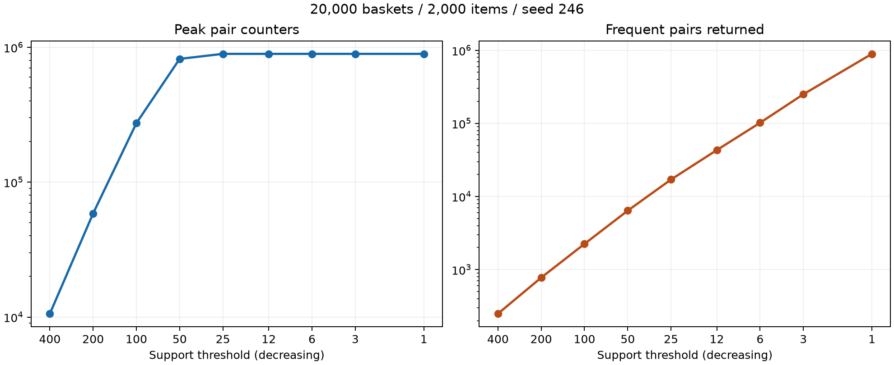

# Task 2: measured support sweep

## Setup
Measured on Windows with Intel Core i9-14900HX, 31.74 GiB physical RAM, Python 3.12.14.
Other observed processes: ChatGPT/Codex, Chrome, Weixin, Douyin and HipsDaemon.
The unchanged `bench.build()` generated 20,000 baskets over 2,000 items using seed 246.
Memory is Python allocation peak measured by tracemalloc inside `run`, excluding the already-built baskets and interpreter; it is not total process RSS.
Timings include tracing overhead and are therefore not directly comparable to untraced `bench.txt`.

## A1, A3: measurements
Nine positive support values span 400x. Values 25 to 12 and 3 to 1 are approximate halvings.

| Support | Peak counters | Frequent pairs | Seconds | Peak MB | Counter growth |
|---:|---:|---:|---:|---:|---:|
| 400 | 10,585 | 249 | 0.839 | 1.06 | - |
| 200 | 58,626 | 776 | 1.442 | 6.38 | 5.539x |
| 100 | 273,701 | 2,244 | 2.314 | 26.39 | 4.669x |
| 50 | 820,259 | 6,397 | 4.125 | 102.17 | 2.997x |
| 25 | 893,456 | 17,045 | 4.855 | 102.17 | 1.089x |
| 12 | 893,456 | 43,116 | 5.085 | 102.72 | 1.000x |
| 6 | 893,456 | 101,938 | 5.232 | 119.36 | 1.000x |
| 3 | 893,456 | 250,054 | 5.672 | 156.59 | 1.000x |
| 1 | 893,456 | 893,456 | 7.856 | 327.02 | 1.000x |

## A2: stopping condition, honestly recorded
No tested positive threshold became unbearable on this machine. Even support 1 finished in 7.86 seconds with 327.02 MB of traced peak allocations.
I stopped at 1 because it is the lowest meaningful positive support; no RAM exhaustion, timeout or manual abort occurred.
The requested failure boundary was therefore **not observed** with the supplied fixed-size dataset. This is a limit of the experiment, not evidence that larger inputs cannot exhaust memory.
Lowering support below 1 would not admit additional observed pairs. A larger dataset would be a separate scaling experiment, not a fabricated failure of this one.

## A4: counter growth
From support 400 to 200, 200 to 100, and 100 to 50, counters grow by 5.539x, 4.669x, and 2.997x respectively: initially worse than doubling.
From 50 to 25 they grow only 1.089x, and below 25 they plateau at 893,456 observed pairs.
The universe is finite and this implementation allocates counters only for observed pairs, not the full quadratic table; all eligible observed pairs are eventually already counted.

## A5: answers versus candidates
At 400, 10,585 counters find 249 answers (42.5 counters per answer); at 50, 820,259 find 6,397 (128.2 per answer).
Across 400 to 50 the counter count grows 77.49x, while answers grow 25.69x: much of the allocation goes to pairs that are discarded.
Below 25 the counter count is flat while answers increase from 17,045 to 893,456 as previously counted rare pairs become frequent.
Thus the claim that answers grow more slowly is true over the early sweep, not universally. At support 1 every observed pair is an answer, and the larger returned dictionary contributes to the 327 MB peak.
